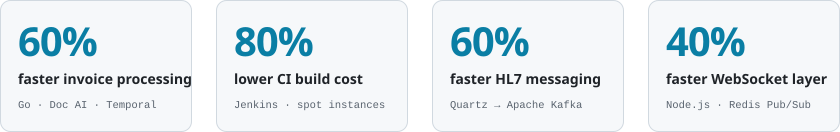

<picture>
  <source media="(prefers-color-scheme: dark)" srcset="assets/banner-dark.svg">
  
</picture>

I'm a backend engineer in Bengaluru with 5+ years of building microservices that have to stay fast and stay up. Currently **SDE II at Livspace** (fulfilment and supply chain), previously at **Practo**. Most of my work lives in private repos, so here is the short version.

<picture>
  <source media="(prefers-color-scheme: dark)" srcset="assets/impact-dark.svg">
  
</picture>

### What I've shipped

- **Automated invoice validation** — a Go pipeline on GCP Document AI and RabbitMQ, later extended with agentic Vertex AI parsing and Temporal orchestration. 60% faster processing at half the operational cost.
- **Legacy rewrite, Node.js to Go** — re-architected a vendor manufacturing and tracking system from Vert.x into a lightweight Go service that is smaller, faster and easier to reason about.
- **Event-driven HL7 messaging** — replaced Quartz scheduled jobs with Apache Kafka in a hospital management system, making message generation and delivery 60% faster.
- **IVR appointment booking** — Spring Boot service modelling each call as a state machine; appointment bookings went up 30%.
- **Cheaper, faster CI** — moved Jenkins builds onto an Auto Scaling group of spot instances, cutting cost by 80% and hours off build times.

### Toolbox

  

Also in regular use: Temporal, Hibernate/JPA, DynamoDB, BigQuery, Vertex AI, and agentic coding workflows with Claude and Copilot.

### On GitHub

- [**Open-Forum-WebApp**](https://github.com/Suhas-C-V/Open-Forum-WebApp) — a forum where users post, vote, comment and earn badges for activity.
- [**weather-connect**](https://github.com/Suhas-C-V/weather-connect) — a Spring Boot service that fetches, formats and serves weather data from RapidAPI.

<picture>
  <source media="(prefers-color-scheme: dark)" srcset="https://raw.githubusercontent.com/Suhas-C-V/Suhas-C-V/output/snake-dark.svg">
  
</picture>

### Say hello

[LinkedIn](https://www.linkedin.com/in/suhas-c-v) · B.E. Computer Science, CMR Institute of Technology (2021)
